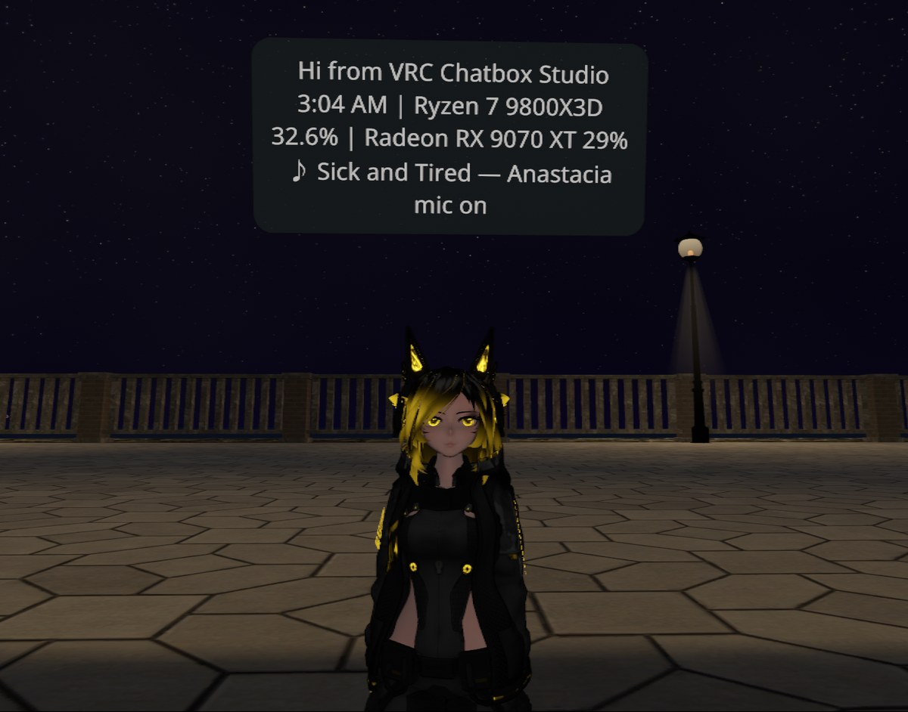
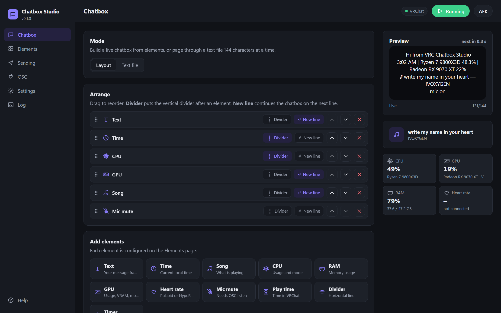
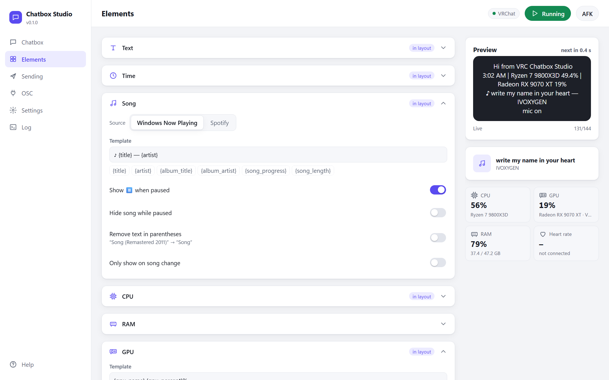
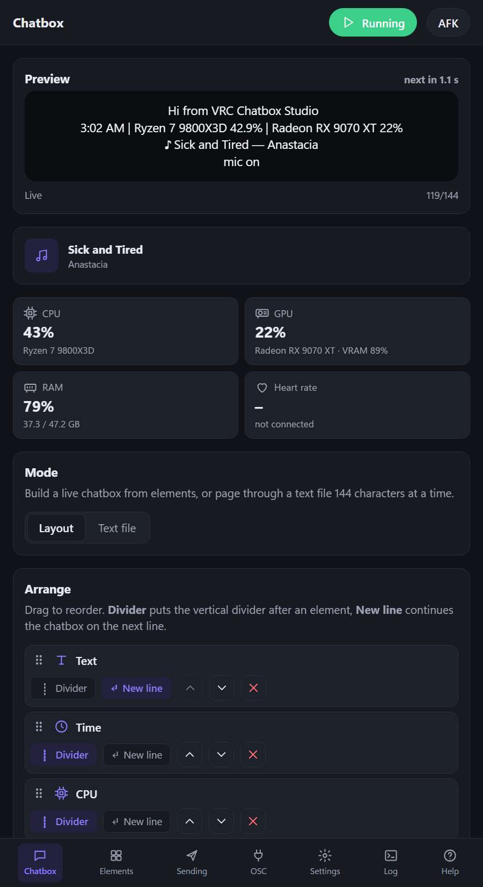

# VRC Chatbox Studio

A live chatbox for VRChat over OSC: build it from elements (text, time, song, CPU, GPU, RAM, heart rate, mic mute, play time, timer), watch a preview, and it updates in the game. Windows, one standalone `.exe`, no installer.





## Features
- **Layout editor** with drag and drop, live chatbox preview and a 144-character counter.
- **Song** from Windows "Now Playing" (any player) or the Spotify API, with progress and length.
- **CPU and GPU usage and model names on any vendor** (NVIDIA, AMD, Intel). The GPU reading follows the card VRChat renders on, so an iGPU or a second card running AI workloads doesn't get in the way. A manual picker is also available.
- **Heart rate** from Pulsoid or HypeRate, also sent to avatar parameters (`HR`, `isHRBeat`, …).
- **Mic mute and automatic AFK** read from VRChat via OSC listen, with a push-to-talk mode (VRChat itself doesn't report push-to-talk as muted). OSC forwarding to other apps.
- **Avatar parameters** for the time (`Hours`, `Minutes`, `Seconds`, `Period`), plus a debug sender.
- **Global hotkeys** to pause and to toggle AFK.
- Light, dark and system theme. The layout works down to phone width.
- **Importing from OSC Chat Tools:** if an install is found (its `please-do-not-delete.txt`), its settings are imported on first start.

## Screenshots
| Element settings (light theme) | Narrow window |
| --- | --- |
|  |  |

## Getting started
1. Turn on OSC in VRChat: Action Menu → Options → OSC → Enabled.
2. Start `VRC-Chatbox-Studio.exe` and add elements on the Chatbox page.
3. For mic mute and automatic AFK, switch on **OSC → Listen to VRChat** (port 9001).

Settings save when you leave a field or press Enter. They are stored in `chatbox-studio.json` next to the exe.

## Spotify
Windows "Now Playing" needs no setup. For the Spotify API (progress, volume, track ID) you need your own Spotify app:
1. Open the [Spotify developer dashboard](https://developer.spotify.com/dashboard) and choose **Create app**.
2. Redirect URI: `http://127.0.0.1:8000/callback`. API: **Web API**.
3. Copy the **Client ID** into Elements → Song → Spotify and click **Link Spotify**.

## Heart rate
- **Pulsoid:** create a token at [pulsoid.net/ui/keys](https://pulsoid.net/ui/keys) and paste it into Elements → Heart rate.
- **HypeRate:** needs a developer API key from HypeRate plus your session ID.

## Build
```
pip install -r requirements.txt
python studio.py            # native window
python studio.py --browser  # UI in the default browser (development)
build.bat                   # dist\VRC-Chatbox-Studio.exe
```
The window is a local web UI (pywebview / Edge WebView2) served by Flask on 127.0.0.1. The API requires a per-run key, so websites can't control it.

## License
MIT, see [LICENSE](LICENSE). Not affiliated with VRChat Inc.
